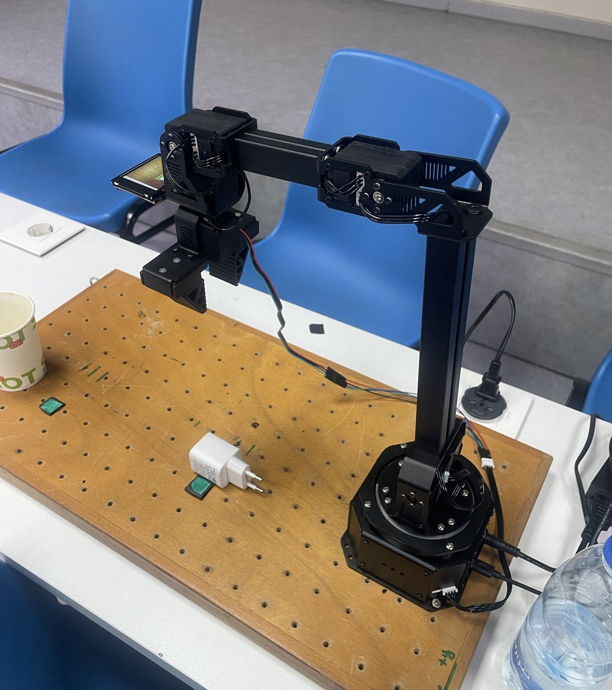
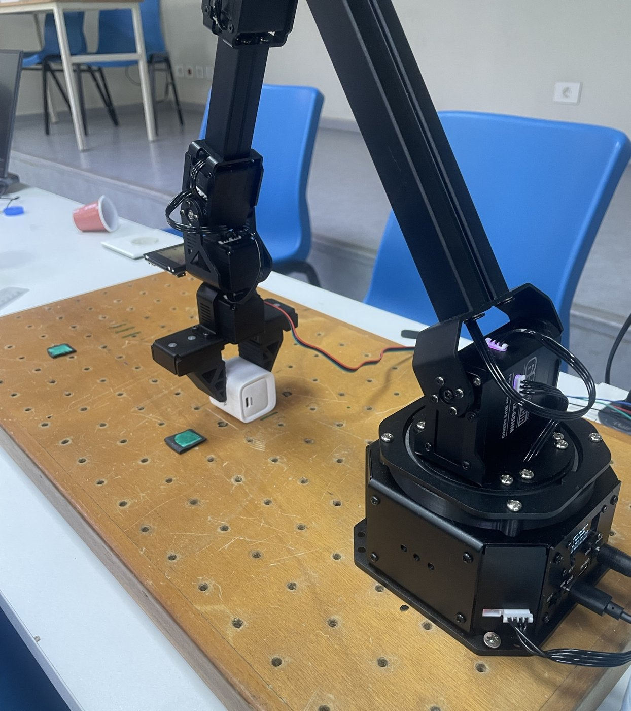
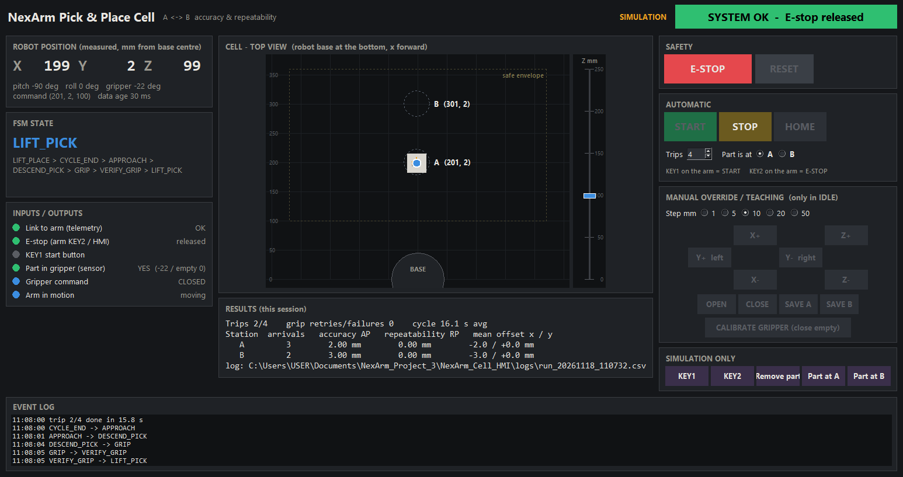
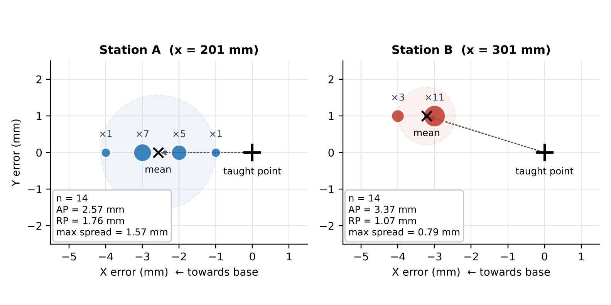
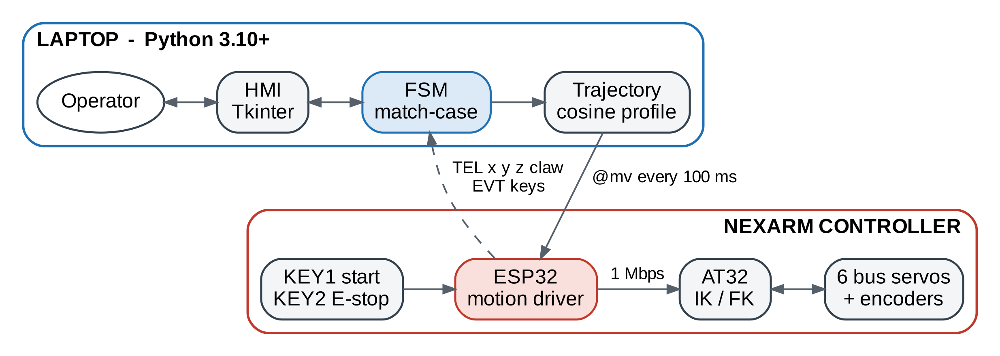
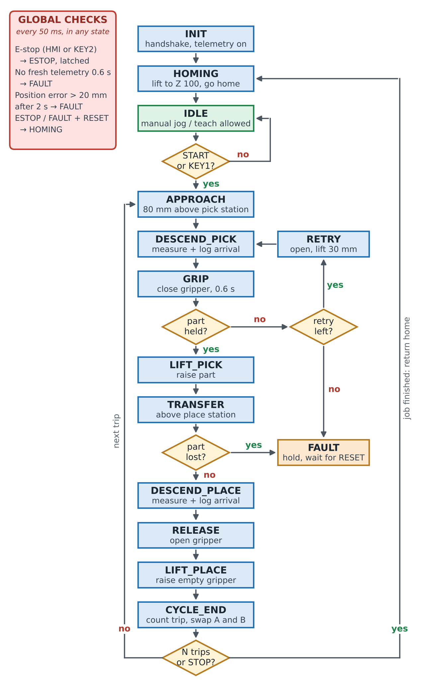
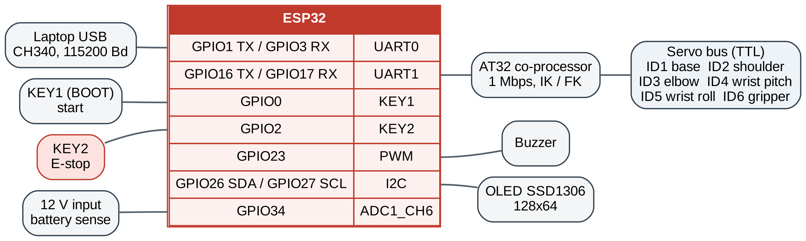

# NexArm Pick-and-Place Cell

An autonomous pick-and-place cell on the **Hiwonder NexArm** 6-axis arm. A 33 mm part travels back and
forth between two **taught** stations, A and B. A Python **`match`/`case` finite state machine** supervises
the job, and an operator **HMI** shows live position, state and safety status. Every arrival is measured
for **ISO 9283 accuracy and repeatability**.

  

<p align="center">
  
  
</p>
<p align="center">
  
</p>

📄 **Full technical report:** [docs/NexArm_Technical_Report.pdf](docs/NexArm_Technical_Report.pdf) ([Word version](docs/NexArm_Technical_Report.docx))

---

## Results

14 autonomous trips on the real arm (28 arrivals, 14 per station):

| Station | Transfers | Mean offset X, Y (mm) | Accuracy AP (mm) | Repeatability RP (mm) | Max. distance from mean (mm) |
|---|---|---|---|---|---|
| A (x = 201 mm) | 14 / 14 | −2.57, 0.00 | 2.57 | 1.76 | 1.57 |
| B (x = 301 mm) | 14 / 14 | −3.21, +1.00 | 3.37 | 1.07 | 0.79 |

<p align="center"></p>

- **No drops and no collisions.** Every arrival stayed within 1.6 mm of its group mean.
- **Constant offset.** The arm always stops 2.6–3.4 mm short of the commanded point, towards the base (gravity sag and servo backlash). Because the stations are **taught with the arm itself**, this offset is already inside the saved poses. That is why teaching beats a camera or ruler measurement for fixed stations.
- **Automatic tests.** All 13 tests of the fault and safety branches pass against the built-in arm simulator.

$$AP=\sqrt{(\bar{x}-x_c)^2+(\bar{y}-y_c)^2}\qquad RP=\bar{l}+3S_l,\quad l_j=\sqrt{(x_j-\bar{x})^2+(y_j-\bar{y})^2}$$

## How it works

<p align="center"></p>

| Layer | Runs on | Job |
|---|---|---|
| **Supervisor** | Laptop, Python 3.10+ | FSM (18 states, one `match` statement), trajectory planning, HMI, CSV logging |
| **Motion driver** | NexArm ESP32 (C++) | Executes 120 ms trajectory segments, streams the measured pose ~10×/s, latches the KEY2 E-stop |
| **Kinematics** | NexArm AT32 | Inverse/forward kinematics, 6 bus servos with encoders |

- **Non-blocking FSM.** `tick()` runs every 50 ms and never sleeps. The global checks run first (E-stop, telemetry freshness, STOP), then one `match self.state:`.
- **Smooth motion.** Each move is a straight line with a cosine velocity profile, $s(t)=\frac{1-\cos(\pi t/T)}{2}$, sampled with `time.time()` and sent as overlapping 120 ms segments.
- **Sensor-driven branches:**
  - The gripper angle verifies the grip; if it's empty, the arm retries once, then faults.
  - A part dropped in transit is detected.
  - The measured pose must reach every target (jam/collision detection).
- **Safety:**
  - Hardware E-stop latched in the firmware, plus an HMI E-stop (button, SPACE or ESC).
  - Lift-first homing.
  - Virtual workspace envelope.
  - 0.6 s telemetry watchdog.

<details>
<summary><b>ASM chart of the FSM</b></summary>
<p align="center"></p>
</details>

<details>
<summary><b>ESP32 pin schematic</b></summary>
<p align="center"></p>
</details>

## Quick start

**1. Try it without hardware (simulator):**

```bash
pip install -r requirements.txt
cd python
python nexarm_hmi.py --sim
```

Press **START**. The simulation panel lets you press KEY1 or KEY2, remove the part or put it back at A or B, so you can trigger every branch of the FSM.

**2. Run the automatic tests:**

```bash
cd python
python test_fsm.py        # 13/13 tests passed
```

**3. With the real arm:**

1. Flash the motion driver: see [firmware/README.md](firmware/README.md).
2. Run `python nexarm_hmi.py --port COM12`, replacing `COM12` with your serial port.
3. In IDLE, jog the gripper onto the part and press **SAVE A**. Repeat for **SAVE B**.
4. Press **CALIBRATE GRIPPER** once with the gripper empty.
5. Set the number of trips and press **START**.

## Repository structure

```
├── python/
│   ├── cell_fsm.py          # the FSM: 18 states, one match statement, safety, ISO 9283 measurement
│   ├── motion.py            # non-blocking cosine trajectories
│   ├── robot_link.py        # serial link (reader thread) + simulated arm
│   ├── nexarm_hmi.py        # Tkinter operator interface (entry point)
│   └── test_fsm.py          # 13 automatic tests
├── firmware/
│   ├── system_task_handle.cpp   # ESP32 motion driver + PC link + stand-alone teaching mode
│   └── README.md                # build and upload instructions
├── data/nexarm_arrivals.csv     # the 28 arrivals measured on the real arm
├── tools/make_results_figure.py # redraws docs/images/results.png from the data
└── docs/                        # technical report (PDF, Word) and figures
```

## Status and limitations

- The measured trips were run with the stand-alone teaching mode of the firmware. The Python FSM and HMI use the same taught points and motion commands; so far they have been validated against the simulator, and a full real-arm run is the next step.
- Positions come from the arm's own encoders at 1 mm resolution. An external check (paper outlines measured with a ruler) is planned.
- The stations are fixed. Parts placed at random would need the camera (HuskyLens), which is listed as future work.

## Author

**Ali Nasser Aldine** designed, built and tested the entire project: the cell layout and station teaching, the ESP32 firmware, the Python FSM, the trajectory planner and the HMI, the test suite, the accuracy and repeatability measurements, and the technical report.

## Acknowledgements

Built on Hiwonder's NexArm platform. The firmware file replaces one file of Hiwonder's official
Arduino example, whose other files are not redistributed here.

## License

[MIT](LICENSE) © 2026 Ali Nasser Aldine
